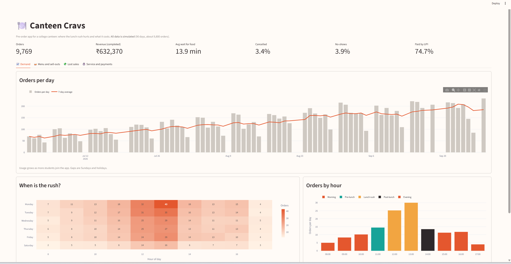
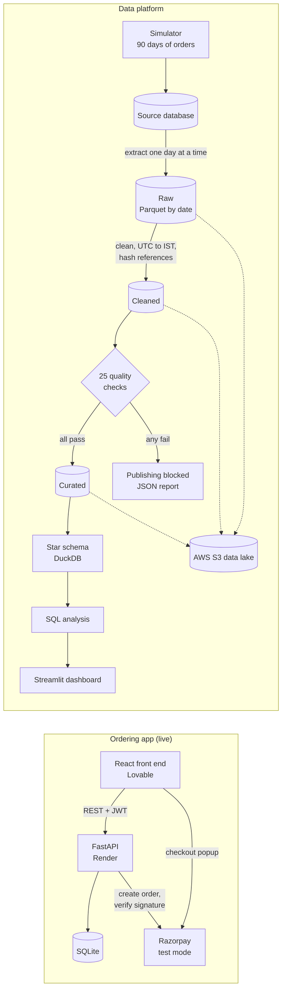

# Canteen Cravs

[](https://github.com/Bhavyarathore21/canteen-cravs/actions/workflows/ci.yml)

A pre-ordering system for a college canteen, built end to end: a **live ordering app** for students and canteen staff
(with online payment in Razorpay test mode), and a **data platform** behind it: pipeline with quality checks,
AWS S3 data lake, star schema warehouse, SQL analysis and a dashboard.

| | |
|---|---|
| **Live app** | https://canteen-cravs.lovable.app |
| **Live dashboard** | https://canteen-cravs.streamlit.app |
| **API documentation** | https://canteen-cravs.onrender.com/docs |

> **First load takes up to a minute.** The API runs on a free host that sleeps when idle. The demo data also resets
> whenever the server restarts, so accounts you register may disappear. That is expected.

## Try it in two minutes

Use the **Student demo** and **Canteen staff demo** buttons on the login page, or log in by hand:

| Role | Email | Password |
|---|---|---|
| Student | `student@canteen.demo` | `student12345` |
| Canteen staff (admin) | `admin@canteen.demo` | `admin12345` |

These are shared, public demo accounts, so they are read-only (no profile edits). You can also register your own account.

1. As the student, add items to the cart, choose **UPI**, place the order, then press **Pay online**.
2. In the Razorpay popup (**test mode, no real money**) use card `4100 2800 0000 1007`, any future expiry, any CVV,
   and choose **Success** on the bank page. (The common `4111 1111 1111 1111` test card is rejected as an
   international card in my test account.)
3. Open the staff demo in a second window. The order appears on the board: **Start preparing**, then **Mark ready**.
4. Watch the student's order tracker move and turn green.

## Screenshots

| Student menu | Order placed |
|---|---|
|  |  |

| Razorpay checkout (test mode) | Order tracker |
|---|---|
|  |  |

| Admin orders board | Admin payments |
|---|---|
|  |  |



## The problem

At lunch time the main canteen has a long queue. Students wait to order, wait again for the food, and by the time
they are served their next class is starting. The idea: **order from anywhere, collect when it is ready.**
I first built this in Java with a friend at college. Here it is rebuilt in Python, and extended with the data
platform a real canteen would need to run well: when does the rush hit, what runs out, and what does that cost?

> **About the data:** the canteen data in the analysis is **simulated** (90 days, about 9,800 orders) by a script
> that models lunch rushes, sell-outs, cancellations and no-shows. The patterns were built into the simulation,
> so the analysis shows the **method** (pipeline, modelling, SQL, validation), not real canteen findings.

## What is inside

**1. The ordering app (`backend/` + a React front end)**

- Student and admin roles, bcrypt password hashing, JWT login, profile editing and password change
- The real admin is created from server settings (never through registration); the shared demo accounts are read-only
- Admin menu management with live stock, a sold-out switch, food photos, and every stock change logged
- Order placement as one **database transaction**: stock is checked and reduced in a single SQL step
  (no overselling the last samosa), and the whole order is rolled back if any item is short
- Pickup codes (A001, A002 ...), prices always read from the server, never from the browser
- Order lifecycle as a validated state machine: Placed, Preparing, Ready, Completed, plus Cancelled and Expired
- Cancellation rules, no-show expiry, and cash orders blocked after 3 no-shows
- **Razorpay online payment (test mode)**, manual UPI reference confirmation, cash, refunds, and a full payment log
- Admin screens: orders board, menu and stock, payments summary

**2. The data platform**

| Stage | Folder | What it does |
|---|---|---|
| Simulate | `backend/simulator.py` | Generates 90 days of realistic orders into a separate database (fixed random seed) |
| Pipeline | `pipeline/` | Extracts day by day, converts UTC to Indian time, cleans, runs 25 quality checks, publishes |
| Data lake | `pipeline/upload_to_s3.py` | Uploads the raw, cleaned and curated layers to AWS S3 (least-privilege IAM user, private bucket) |
| Warehouse | `warehouse/build_warehouse.py` | Builds a star schema in DuckDB with referential integrity checks |
| Analysis | `warehouse/analysis.sql` | 12 business questions answered in SQL |
| Dashboard | `dashboard/app.py` | Streamlit dashboard reading the analysis results |
| CI | `.github/workflows/ci.yml` | Runs the tests, simulator, pipeline, warehouse and analysis on every push |

## Architecture



The star schema:

```
              dim_date    dim_time
                  \         /
 dim_user ---- fact_orders ---- fact_order_items ---- dim_menu_item
                                fact_stock_events ---- dim_menu_item
                                fact_payment_events
```

## How online payment is kept safe

1. The browser asks the server to start a payment. The server reads the order's total **from the database** and
   asks Razorpay to create a payment for exactly that amount (in paise).
2. The student pays inside Razorpay's popup. Razorpay returns a payment id and a **signature**.
3. The server re-computes the signature (HMAC-SHA256 of `order_id|payment_id` with the **secret key**) and only
   marks the order `Paid` if it matches.

The secret key lives only in server settings, never in the browser or in GitHub. A forged signature, a payment
made for a different order, or someone else's order is refused, and verifying twice is harmless. These cases are
covered by automated tests that use a simulated Razorpay.

## What the analysis found (simulated data)

| Question | Answer |
|---|---|
| Is the app growing? | Weekly orders rose from 473 to 1,059 over the 90 days |
| When is the rush? | 1 pm is busiest (about 30 orders per day). Students wait **17.0 minutes** on average at 1 pm (9 in 10 wait under 22.7), against 10.6 at 8 am |
| What brings in the money? | Meals are 55% of revenue, Veg Thali alone is 26% |
| What runs out? | Samosas sell out on 22 of 73 open days, around 4 pm. Chole Bhature on 13 days, around 2:15 pm |
| What does running out cost? | An estimated **Rs 17,982** (537 items) in lost sales. Chole Bhature is the biggest loss |
| Who causes no-shows? | 3.9% of orders are never collected. **30 students (5%) cause half of all no-shows** |
| What do cash no-shows cost? | Rs 7,465 of food made and never paid for |

### How the lost-sales estimate works, and how good it is

Nobody records students who wanted something that had already run out, so the loss has to be estimated:

1. On days an item was still available, measure how many units of it each order contained, hour by hour.
2. On days it sold out, take the orders placed after the sell-out and apply the same rate.

Because the data is simulated, the **true loss is known**: Rs 23,415 (732 items). The estimate finds about
**77%** of it and ranks the items in the correct order. It is conservative because students who wanted only
the sold-out item never placed an order, so the data cannot see them.

## Data quality

The pipeline refuses to publish bad data. The 25 checks cover:

- **Completeness and uniqueness:** required columns present, no duplicate order ids, no reused UPI reference
- **Valid values:** statuses, payment methods and payment statuses from the allowed lists, positive amounts
- **Consistency:** order totals equal the sum of their lines, no orphan rows, every order has items
- **Timelines:** Placed, Preparing, Ready and Completed happen in order, and the final status has a matching event
- **Reconciliation:** row counts in the data lake match the source database

If any serious check fails, nothing reaches the cleaned or curated layers and a JSON report explains why.
`pipeline/make_bad_data.py` deliberately breaks five things so you can watch the checks catch them,
and the CI workflow does exactly that on every run.

**Privacy:** names, emails and password hashes are never extracted from the app database into the data lake, and
UPI reference numbers are replaced by a one-way hash.

## Tech stack

Python, FastAPI, SQLite, pandas, PyArrow (Parquet), DuckDB, SQL (CTEs and window functions), AWS S3 and IAM,
Razorpay (test mode), React (Lovable), Streamlit, Plotly, pytest, GitHub Actions, Render.

## Project structure

```
canteen-cravs/
├── backend/      FastAPI app: auth, menu, orders, payments, profile, Razorpay; simulator; food images
├── pipeline/     Extract, transform, quality checks, S3 upload
├── warehouse/    Star schema build and SQL analysis
├── dashboard/    Streamlit dashboard and its small CSV inputs
├── tests/        57 pytest tests (pipeline, Razorpay payments, profile and admin setup)
├── docs/         Screenshots
└── .github/workflows/ci.yml
```

## Run it yourself (Windows PowerShell)

```powershell
git clone https://github.com/Bhavyarathore21/canteen-cravs.git
cd canteen-cravs
python -m venv .venv
.venv\Scripts\activate
pip install -r backend/requirements.txt -r pipeline/requirements.txt -r warehouse/requirements.txt -r dashboard/requirements.txt -r requirements-dev.txt
```

**The data project** (needs no AWS account):

```powershell
pytest                                   # 57 tests
cd backend;   python simulator.py        # creates backend/canteen_sim.db
cd ..\pipeline;  python run_pipeline.py  # raw -> cleaned -> checks -> curated
cd ..\warehouse; python build_warehouse.py
python run_analysis.py                   # 12 queries, saved as CSV
cd ..; streamlit run dashboard/app.py
```

**The ordering backend:**

```powershell
cd backend
$key = python -c "import secrets; print(secrets.token_hex(32))"
"SECRET_KEY=$key" | Out-File -Encoding ascii .env
uvicorn main:app --reload                # then open http://127.0.0.1:8000/docs
```

Settings (environment variables, or `backend/.env` locally):

| Variable | Purpose |
|---|---|
| `SECRET_KEY` | Signs login tokens (required) |
| `ADMIN_EMAIL`, `ADMIN_PASSWORD`, `ADMIN_NAME` | Creates the real admin account on every start |
| `RAZORPAY_KEY_ID`, `RAZORPAY_KEY_SECRET` | Razorpay **test** keys for online payment |
| `ALLOWED_ORIGINS`, `ALLOWED_ORIGIN_REGEX` | Which front-end addresses may call the API (Lovable domains are allowed by default) |

**Optional, upload the data lake to S3** (needs your own bucket and `aws configure`):

```powershell
cd pipeline
python upload_to_s3.py --bucket YOUR-BUCKET-NAME --region YOUR-REGION
```

## Design decisions worth knowing

- **No overselling:** `UPDATE ... SET stock = stock - n WHERE stock >= n` checks and reduces stock in one step, inside a transaction.
- **The server decides prices and payment status**, never the client.
- **Registration can never create an admin.** The real admin comes from server settings, and the shared demo accounts are read-only.
- **Idempotent pipeline:** each day is its own partition, so re-running a day overwrites it and never duplicates it.
- **Time zones:** the app stores UTC, the analysis uses Indian time, and the day an order belongs to is decided in Indian time.
- **A quality gate, not just a report:** failing checks stop publishing.
- **History tables** (`order_status_log`, `stock_log`, `payment_log`) exist because the analysis needs them: wait times, sell-out times and payment timelines come from them.

## Limitations and next steps

- The analysis data is simulated. The pipeline would work the same way on real orders.
- Payments run in Razorpay test mode only. Refunds are marked manually by the admin.
- The free host resets the demo database on restart. A real deployment would use a managed database.
- Login tokens last 12 hours and are not revoked when a password changes.
- The pipeline runs on demand. A scheduler such as Airflow, and incremental warehouse loads, would be the next step.

## How this was built

Built with AI assistance. Claude helped write the backend, pipeline and analysis code, and Lovable generated the
React front end from my prompts. I set up, ran, tested, debugged and deployed everything (GitHub, AWS, Render,
Razorpay, Streamlit) and can walk through each part of the code.

Built by Bhavya Rathore.
