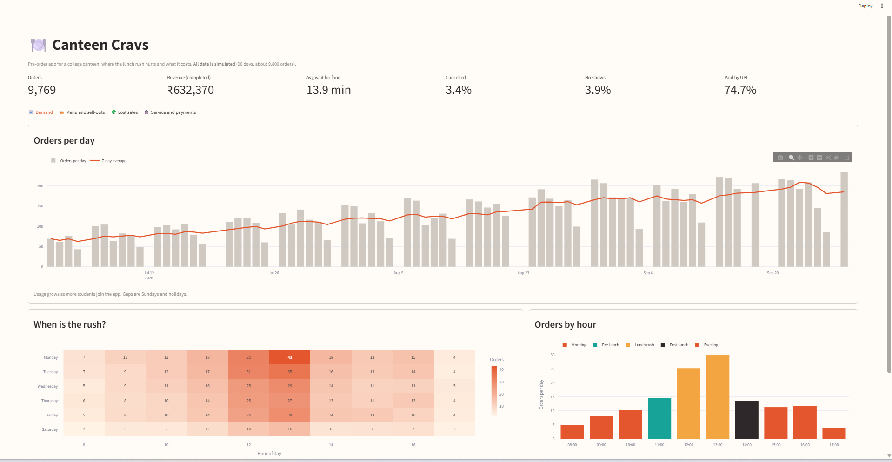
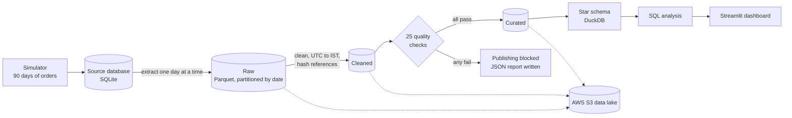

# Canteen Cravs

[](https://github.com/Bhavyarathore21/canteen-cravs/actions/workflows/ci.yml)

A pre-ordering system for a college canteen, built end to end: an **ordering backend**, a **data pipeline**
with quality checks, a **data lake on AWS S3**, a **star schema warehouse**, **SQL analysis** and a **dashboard**.

> **About the data:** the canteen data in this project is **simulated** (90 days, about 9,800 orders) by a script
> that models lunch rushes, sell-outs, cancellations and no-shows. The patterns were built into the simulation,
> so this project shows the **method** (pipeline, modelling, SQL, validation), not real canteen findings.



## The problem

At lunch time the main canteen has a long queue. Students wait to order, wait again for the food, and by the time
they are served their next class is starting. The idea: **order from anywhere, collect when it is ready.**
I first built this in Java with a friend at college. Here it is rebuilt in Python, and extended with the data
platform a real canteen would need to run well: when does the rush hit, what runs out, and what does that cost?

## What is inside

**1. Ordering backend (`backend/`)** - FastAPI and SQLite

- Student and admin roles, passwords hashed with bcrypt, JWT login tokens
- Admin menu management with live stock and a sold-out switch, every stock change logged
- Order placement as one **database transaction**: stock is checked and reduced in a single SQL step
  (no overselling the last samosa), and the whole order is rolled back if any item is short
- Pickup codes (A001, A002 ...), prices read from the server (never trusted from the client)
- Order lifecycle as a validated state machine: Placed, Preparing, Ready, Completed, plus Cancelled and Expired
- Cancellation rules, no-show expiry, and cash orders blocked after 3 no-shows
- UPI (reference number, admin confirmation) and cash payments, refunds, and a full payment log

**2. Data platform**

| Stage | Folder | What it does |
|---|---|---|
| Simulate | `backend/simulator.py` | Generates 90 days of realistic orders into a separate database (fixed random seed) |
| Pipeline | `pipeline/` | Extracts day by day, converts UTC to Indian time, cleans, runs 25 quality checks, publishes |
| Data lake | `pipeline/upload_to_s3.py` | Uploads the raw, cleaned and curated layers to AWS S3 (least-privilege IAM user, private bucket) |
| Warehouse | `warehouse/build_warehouse.py` | Builds a star schema in DuckDB with referential integrity checks |
| Analysis | `warehouse/analysis.sql` | 12 business questions answered in SQL |
| Dashboard | `dashboard/app.py` | Streamlit dashboard reading the analysis results |
| CI | `.github/workflows/ci.yml` | Runs tests, simulator, pipeline, warehouse and analysis on every push |

## Architecture



The star schema:

```
              dim_date    dim_time
                  \         /
 dim_user ---- fact_orders ---- fact_order_items ---- dim_menu_item
                                fact_stock_events ---- dim_menu_item
                                fact_payment_events
```

## What the analysis found (simulated data)

| Question | Answer |
|---|---|
| Is the app growing? | Weekly orders rose from 473 to 1,059 over the 90 days |
| When is the rush? | 1 pm is busiest (about 30 orders per day). Students wait **17.0 minutes** on average at 1 pm (9 in 10 wait under 22.7), against 10.6 at 8 am |
| What brings in the money? | Meals are 55% of revenue, Veg Thali alone is 26% |
| What runs out? | Samosas sell out on 22 of 73 open days, around 4 pm. Chole Bhature on 13 days, around 2:15 pm |
| What does running out cost? | An estimated **Rs 17,982** (537 items) in lost sales. Chole Bhature is the biggest loss |
| Who causes no-shows? | 3.9% of orders are never collected. **30 students (5%) cause half of all no-shows** |
| What do cash no-shows cost? | Rs 7,465 of food made and never paid for |

### How the lost-sales estimate works, and how good it is

Nobody records students who wanted something that had already run out, so the loss has to be estimated:

1. On days an item was still available, measure how many units of it each order contained, hour by hour.
2. On days it sold out, take the orders placed after the sell-out and apply the same rate.

Because the data is simulated, the **true loss is known**: Rs 23,415 (732 items). The estimate finds about
**77%** of it and ranks the items in the correct order. It is conservative because students who wanted only
the sold-out item never placed an order, so the data cannot see them.

## Data quality

The pipeline refuses to publish bad data. The 25 checks cover:

- **Completeness and uniqueness:** required columns present, no duplicate order ids, no reused UPI reference
- **Valid values:** statuses, payment methods and payment statuses from the allowed lists, positive amounts
- **Consistency:** order totals equal the sum of their lines, no orphan rows, every order has items
- **Timelines:** Placed, Preparing, Ready and Completed happen in order, and the final status has a matching event
- **Reconciliation:** row counts in the data lake match the source database

If any serious check fails, nothing reaches the cleaned or curated layers and a JSON report explains why.
`pipeline/make_bad_data.py` deliberately breaks five things so you can watch the checks catch them,
and the CI workflow does exactly that on every run.

**Privacy:** names, emails and password hashes are never extracted from the app database, and UPI reference
numbers are replaced by a one-way hash.

## Tech stack

Python, FastAPI, SQLite, pandas, PyArrow (Parquet), DuckDB, SQL (CTEs and window functions),
AWS S3 and IAM, Streamlit, Plotly, pytest, GitHub Actions.

## Project structure

```
canteen-cravs/
├── backend/      FastAPI app (auth, menu, orders, payments), database layer, simulator
├── pipeline/     Extract, transform, quality checks, S3 upload
├── warehouse/    Star schema build and SQL analysis
├── dashboard/    Streamlit dashboard and its small CSV inputs
├── tests/        pytest tests for the pipeline
├── docs/         Screenshots
└── .github/workflows/ci.yml
```

## Run it yourself (Windows PowerShell)

```powershell
git clone https://github.com/Bhavyarathore21/canteen-cravs.git
cd canteen-cravs
python -m venv .venv
.venv\Scripts\activate
pip install -r backend/requirements.txt -r pipeline/requirements.txt -r warehouse/requirements.txt -r dashboard/requirements.txt -r requirements-dev.txt
```

**The data project** (needs no AWS account):

```powershell
pytest                                   # 21 tests
cd backend;   python simulator.py        # creates backend/canteen_sim.db
cd ..\pipeline;  python run_pipeline.py  # raw -> cleaned -> checks -> curated
cd ..\warehouse; python build_warehouse.py
python run_analysis.py                   # 12 queries, saved as CSV
cd ..; streamlit run dashboard/app.py
```

**The ordering backend:**

```powershell
cd backend
$key = python -c "import secrets; print(secrets.token_hex(32))"
"SECRET_KEY=$key" | Out-File -Encoding ascii .env
uvicorn main:app --reload                # then open http://127.0.0.1:8000/docs
```

**Optional, upload the data lake to S3** (needs your own bucket and `aws configure`):

```powershell
cd pipeline
python upload_to_s3.py --bucket YOUR-BUCKET-NAME --region YOUR-REGION
```

## Design decisions worth knowing

- **No overselling:** `UPDATE ... SET stock = stock - n WHERE stock >= n` checks and reduces stock in one step, inside a transaction.
- **The server decides prices and payment status**, never the client.
- **Idempotent pipeline:** each day is its own partition, so re-running a day overwrites it and never duplicates it.
- **Time zones:** the app stores UTC, the analysis uses Indian time, and the day an order belongs to is decided in Indian time.
- **A quality gate, not just a report:** failing checks stop publishing.
- **History tables** (`order_status_log`, `stock_log`, `payment_log`) exist because the analysis needs them: wait times, sell-out times and payment timelines come from them.

## Limitations and next steps

- The data is simulated. The pipeline would work the same way on real orders.
- A React frontend for students and the admin (built with Lovable, calling this API) is planned, along with Razorpay test-mode payments.
- The pipeline runs on demand. A scheduler such as Airflow, and incremental warehouse loads, would be the next step.

Built by Bhavya Rathore.
